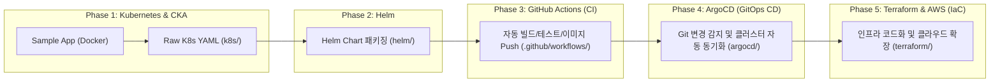

# 00. DevOps 엔지니어 통합 학습 로드맵 (Roadmap)

> **문서 목적**: 이 문서는 Docker/Linux 기본 지식을 갖춘 입문자가 **Kubernetes(CKA 취득 포함), Helm, GitHub Actions, ArgoCD, Terraform & AWS**를 하나의 유기적인 프로젝트로 연결하며 마스터하기 위한 전체 로드맵을 정의합니다.

---

## 1. 학습 철학: "하나의 애플리케이션을 실무 아키텍처로 진화시키기"

각 툴을 파편화된 예제로 배우면 실무에서 **"그래서 이 툴들이 어떻게 연결되는가?"**를 이해하기 어렵습니다.
따라서 본 레포지토리에서는 하나의 샘플 웹 애플리케이션(`app/`)을 시작점으로 삼아, 단계(Phase)마다 데브옵스 도구를 하나씩 도입하며 아키텍처를 고도화합니다.

---

## 2. 로컬 실습 환경 구성 전략 (Zero-Cost & CKA Ready)

과금 걱정 없이 로컬(Mac) 환경에서 실무 및 CKA 시험과 100% 동일한 수준의 실습을 진행하기 위해 다음 도구들을 사용합니다.

| 구분 | 사용 도구 | 용도 및 선택 이유 |
| :--- | :--- | :--- |
| **컨테이너 런타임** | Docker Desktop (또는 OrbStack / Colima) | 로컬 컨테이너 빌드 및 `Kind` 클러스터의 노드를 컨테이너로 구동 |
| **주력 K8s 클러스터** | **Kind (Kubernetes IN Docker)** | 단일 노드가 아닌 **멀티 노드(Control Plane 1 + Worker 2~3)** 클러스터를 수십 초 내에 생성/삭제 가능. Ingress, NetworkPolicy, CNI 실습에 최적 |
| **CKA 전용 클러스터** | **Multipass (또는 Lima/UTM) Ubuntu VM + `kubeadm`** | CKA 시험 핵심인 `kubeadm init/join`, 클러스터 버전 업그레이드, `etcd` 백업/복구, `systemd` 레벨의 `kubelet` 트러블슈팅 실습용 |
| **클라우드 에뮬레이터** | **LocalStack + Terraform Kubernetes/Helm Provider** | AWS 과금 없이 로컬에서 VPC, S3, IAM, DynamoDB 등 Terraform 코드를 테스트하거나, 로컬 Kind 클러스터 위에 Terraform으로 리소스를 프로비저닝 |

---

## 3. 단계별 마일스톤 요약

### Phase 1: Kubernetes 코어 마스터 및 CKA 완벽 대비 ([`01-kubernetes-and-cka.md`](./01-kubernetes-and-cka.md))
- **목표**: 샘플 앱을 순수 Kubernetes YAML(`k8s/`)로 배포하고, 클러스터 운영/관리 능력(CKA 수준)을 확보합니다.
- **산출물**: `Deployment`, `Service`, `Ingress`, `ConfigMap`, `Secret`, `PV/PVC`, `NetworkPolicy`, `RBAC` 매니페스트 및 `Kind` 멀티 노드 설정 파일.

### Phase 2: Helm을 통한 매니페스트 패키징 및 환경 분리 ([`02-helm.md`](./02-helm.md))
- **목표**: Phase 1에서 작성한 수많은 YAML 파일의 중복을 제거하고, `dev` / `staging` / `prod` 환경별로 손쉽게 배포할 수 있는 Helm Chart(`helm/`)로 변환합니다.
- **산출물**: 커스텀 Helm Chart, 환경별 `values-*.yaml`, 헬퍼 템플릿(`_helpers.tpl`), 릴리스 롤백 및 생명주기 실습 기록.

### Phase 3: GitHub Actions를 활용한 CI 파이프라인 구축 ([`03-github-actions.md`](./03-github-actions.md))
- **목표**: 애플리케이션 코드가 변경될 때 자동으로 테스트, Docker 이미지 빌드, 보안 취약점 스캔(Trivy), 컨테이너 레지스트리(GHCR) Push, 그리고 Helm `values.yaml`의 이미지 태그를 자동 업데이트하는 CI 워크플로우(`.github/workflows/`)를 구축합니다.
- **산출물**: CI 파이프라인 YAML, 멀티 스테이지 `Dockerfile`, 이미지 태그 자동 범프(Bump) 워크플로우.

### Phase 4: ArgoCD를 활용한 선언적 GitOps CD 구축 ([`04-argocd.md`](./04-argocd.md))
- **목표**: CI 파이프라인이 Git 레포지토리의 Helm 이미지 태그를 변경하면, 클러스터 내부의 ArgoCD가 이를 감지하여 자동으로 배포(Sync)하는 완성형 GitOps 파이프라인(`argocd/`)을 구축합니다.
- **산출물**: ArgoCD `Application`, `AppProject`, `ApplicationSet`, App-of-Apps 패턴 매니페스트.

### Phase 5: Terraform & AWS 인프라 코드화(IaC) ([`05-terraform-and-aws.md`](./05-terraform-and-aws.md))
- **목표**: 수동으로 설치하던 클러스터 애드온(ArgoCD, Ingress Controller 등)을 Terraform 코드로 관리하고, 나아가 AWS 핵심 네트워크(VPC, Subnet)와 컴퓨팅/EKS 아키텍처를 Terraform 모듈(`terraform/`)로 설계합니다.
- **산출물**: Terraform 모듈 구조(`modules/`, `environments/`), LocalStack 및 AWS 연동 테라폼 코드.

---

## 4. 학습 진행 방법 (How to Use This Repo)

1. 각 단계의 커리큘럼 문서를 순서대로 읽으며 현재 학습할 모듈(Module)을 선택합니다.
2. AI 에이전트에게 **"Phase 1의 Module 1 실습을 시작하자"**와 같이 요청합니다.
3. 에이전트가 개념 설명과 함께 상세한 주석이 달린 실습 파일을 생성하면, 안내된 검증 명령어를 직접 터미널에서 실행하며 동작을 확인합니다.
4. 실습이 끝나면 본인이 이해한 내용을 바탕으로 직접 `git status`, `git diff`를 확인하고 로컬/원격 커밋을 주도적으로 관리합니다.

