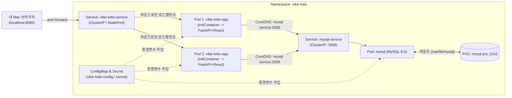

# Module 2: 핵심 워크로드와 Vibe Lotto 6/45 + MySQL 배포 실습

> **학습 목표**: 왜 파드(Pod)를 직접 만들지 않고 `Deployment`와 `Service`를 사용하는지 아키텍처 원리를 이해하고, 우리가 만든 **Vibe Lotto 6/45 풀스택 컨테이너**와 **MySQL 8.0 데이터베이스**를 멀티 노드 클러스터에 배포하여 **파드 간 DNS 통신, 영구 볼륨(PVC), InitContainer, 무중단 로드밸런싱**을 직접 눈으로 확인합니다.

## 1. 개념과 원리 (Why & How)

### 1.1 왜 Pod를 직접 생성하지 않고 `Deployment`를 쓰는가?
- **Pod의 휘발성**: `kind: Pod`로 직접 띄운 파드는 노드가 죽거나 삭제되면 영원히 사라집니다.
- **선언적 상태 유지(Reconciliation Loop)**: `Deployment`를 사용하면 내부적으로 `ReplicaSet`을 생성하여 **"항상 2개의 파드(`replicas: 2`)가 떠 있어야 한다"**는 원하는 상태(Desired State)를 감시합니다. 파드 하나를 강제로 지워도(`kubectl delete pod`) 컨트롤러가 1초 만에 새로운 파드를 다시 띄워줍니다.
- **무중단 롤링 업데이트(RollingUpdate)**: 새 버전의 이미지를 배포할 때 새 ReplicaSet의 파드를 하나씩 늘리고 기존 ReplicaSet의 파드를 하나씩 줄여서 서비스 중단 없이 버전을 교체합니다.

### 1.2 배포 아키텍처 다이어그램



---

## 2. 단계별 실습 가이드 (Step-by-Step Hands-On)

먼저 [Module 1 가이드](../00-cluster/README.md)의 클러스터가 떠 있는지 확인하고, 아래 순서대로 터미널에서 직접 실행해 보세요!

### Step 1: 멀티 노드 `Kind` 클러스터 생성 확인
아직 `vibe-cluster`를 만들지 않았다면 먼저 클러스터를 생성합니다.

```bash
# 1. kind가 없다면 설치
brew install kind

# 2. 3노드(Control Plane 1 + Worker 2) 클러스터 생성
kind create cluster --config k8s/00-cluster/kind-config.yaml

# 3. 노드 3대가 Ready 상태인지 확인
kubectl get nodes
```

### Step 2: Vibe Lotto 6/45 Docker 이미지 빌드 및 Kind 클러스터에 적재 (중요!)
Kind 클러스터의 노드들은 내 Mac의 로컬 Docker 이미지 목록을 직접 보지 못합니다(각 노드가 독립된 컨테이너이기 때문). 따라서 이미지를 빌드한 후 **`kind load docker-image`** 명령으로 클러스터 워커 노드들 내부에 이미지를 넣어주어야 합니다.

```bash
# 1. app/ 디렉토리의 Multi-stage Dockerfile로 이미지 빌드
docker build -t vibe-lotto:1.0.0 ./app

# 2. 빌드된 이미지를 vibe-cluster의 모든 노드에 복사(Load)
kind load docker-image vibe-lotto:1.0.0 --name vibe-cluster

# 3. 워커 노드에 이미지가 잘 들어갔는지 확인
docker exec -it vibe-cluster-worker crictl images | grep vibe-lotto
```

### Step 3: K8s 매니페스트 순차 적용 및 상태 관찰
작성된 4개의 매니페스트 파일을 순서대로 클러스터에 적용합니다.

```bash
# 1. 전용 네임스페이스(vibe-lotto) 생성
kubectl apply -f k8s/01-workloads/00-namespace.yaml

# (CKA 필수 꿀팁!) 현재 kubectl의 기본 네임스페이스를 'vibe-lotto'로 고정합니다.
# 이제 매번 '-n vibe-lotto'를 타이핑하지 않아도 됩니다!
kubectl config set-context --current --namespace=vibe-lotto

# 2. ConfigMap 및 Secret 생성 및 확인
kubectl apply -f k8s/01-workloads/01-config-and-secret.yaml
kubectl get configmap,secret

# 3. MySQL PVC, Deployment, Service 배포
kubectl apply -f k8s/01-workloads/02-mysql.yaml

# 4. Vibe Lotto 앱 Deployment(replicas: 2) 및 Service 배포
kubectl apply -f k8s/01-workloads/03-vibe-lotto-app.yaml
```

### Step 4: InitContainer 및 파드 기동 과정 실시간 모니터링
```bash
# 파드들이 Init:0/1 -> PodInitializing -> Running (1/1)으로 변하는 과정을 실시간 감시합니다.
kubectl get pods -o wide -w
```
> **관찰 포인트**:
> - `mysql-...` 파드가 아직 준비 중일 때 `vibe-lotto-app-...` 파드들은 `Init:0/1` 상태에서 기다립니다.
> - `initContainers`(`wait-for-mysql`)의 로그를 직접 확인해 보세요:
>   `kubectl logs <vibe-lotto-app-파드이름> -c wait-for-mysql`
> - MySQL이 3306 포트를 열면 InitContainer가 완료되고 메인 FastAPI 컨테이너가 기동되어 `1/1 Running`이 됩니다!

---

## 3. 검증 및 CKA 실전 테스트 (Verify & Experiment)

### 실험 1: 브라우저 접속 및 파드 로드밸런싱 눈으로 확인하기
```bash
# vibe-lotto-service의 80 포트를 내 Mac의 8080 포트로 연결
kubectl port-forward svc/vibe-lotto-service 8080:80
```
1. 브라우저에서 **http://localhost:8080** 에 접속합니다.
2. 번호를 선택하거나 **⚡ 빠른 새 번호 자동 추첨** 버튼을 여러 번 눌러보세요.
3. 추첨 결과 카드 우측 하단과 상단 상태바의 **`Pod: vibe-lotto-app-...`** 호스트네임을 유심히 보세요!
4. 또한 5등 이상 당첨되었을 때 우측 **🏆 명예의 전당**에 `DB #1`, `DB #2`와 같이 MySQL에 영구 저장되는 것을 확인하세요.

### 실험 2: Self-Healing (자가 치유) 및 MySQL 영구 볼륨(PVC) 검증
과연 파드가 죽어도 Kubernetes가 자동으로 살려내고, MySQL에 저장된 5등 이상 당첨 기록이 날아가지 않고 유지될까요? 새 터미널 탭을 열고 직접 파드를 폭파해 봅시다!

```bash
# 1. 백엔드 앱 파드 중 1개를 강제로 삭제해 봅니다.
kubectl delete pod -l app.kubernetes.io/name=vibe-lotto-app

# 2. 즉시 다시 조회해 보면 Deployment(ReplicaSet)가 새로운 이름으로 2개를 즉시 복구한 것을 볼 수 있습니다!
kubectl get pods

# 3. 이번에는 MySQL 파드 자체를 강제로 삭제해 봅니다!
kubectl delete pod -l app.kubernetes.io/name=mysql

# 4. 새로운 MySQL 파드가 Running(1/1)이 될 때까지 잠시 기다린 후,
#    브라우저를 새로고침해 보세요. 우측 명예의 전당(5등 이상 당첨 기록)이 그대로 살아있나요?
kubectl get pvc mysql-pvc
```
> **원리**: MySQL 파드는 삭제되었지만, 데이터가 저장된 `mysql-pvc`(`PersistentVolumeClaim`) 볼륨이 새로 뜬 MySQL 파드의 `/var/lib/mysql`에 다시 마운트되었기 때문에 당첨 기록이 100% 보존됩니다!

---

## 4. CKA 시험 단골 명령어 요약

| 작업 목적 | CKA 시험용 명령어 |
| :--- | :--- |
| **Deployment YAML 초안 빠르게 생성** | `kubectl create deploy my-app --image=nginx --replicas=2 --dry-run=client -o yaml > deploy.yaml` |
| **Deployment를 Service로 노출하는 YAML 생성** | `kubectl expose deploy my-app --port=80 --target-port=8000 --type=NodePort --dry-run=client -o yaml > svc.yaml` |
| **Service가 파드들을 제대로 찾고 있는지(Endpoint) 확인** | `kubectl get endpoints vibe-lotto-service` (여기에 IP가 비어 있으면 Service의 `selector`와 Pod의 `labels`가 일치하지 않는 것입니다!) |
| **특정 컨테이너(예: InitContainer) 로그 확인** | `kubectl logs <pod-name> -c <init-container-name>` |
| **파드 내부에서 환경변수나 DB 연결 직접 확인** | `kubectl exec -it <mysql-pod-name> -- mysql -ulotto_user -plotto_pass vibe_lotto -e "SELECT * FROM lotto_winning_records;"` |

