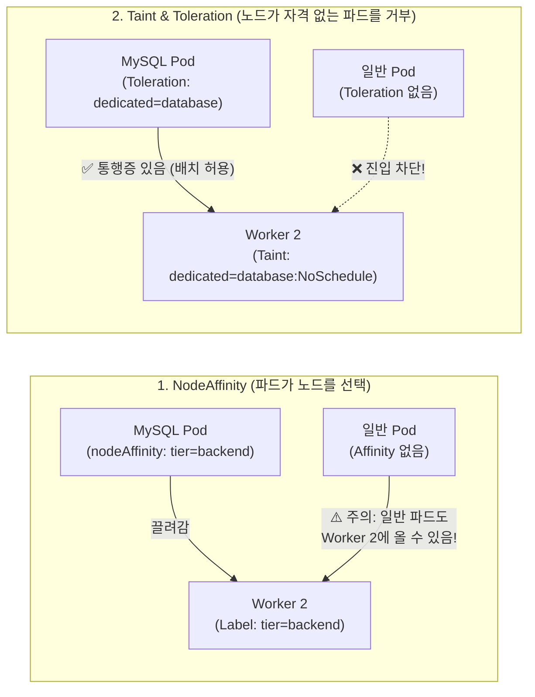

# Module 3: 고급 스케줄링 (Affinity, Taints/Tolerations) 및 특수 워크로드 (Job, CronJob, DaemonSet)

> **학습 목표**: Kubernetes 스케줄러(`kube-scheduler`)가 파드를 특정 노드에 유도하거나(`Affinity`), 반대로 특정 노드에 일반 파드가 못 오게 막는(`Taints & Tolerations`) 원리를 이해하고, 일회성/주기적 배치 작업(`Job`/`CronJob`)과 노드 에이전트(`DaemonSet`)를 실습합니다.

---

## 1. 개념과 원리 (Why & How)

### 1.1 `nodeAffinity`(끌어당김) vs `Taints & Tolerations`(밀어냄과 면역)
CKA 시험과 면접에서 가장 자주 묻는 차이점입니다:



- **`nodeAffinity`만 쓰면?**: MySQL 파드는 `tier=backend` 노드로 가지만, 다른 일반 파드들도 그 노드에 함께 들어올 수 있습니다.
- **`Taint`만 쓰면?**: 일반 파드는 못 들어오지만, 정작 MySQL 파드가 Taint가 없는 다른 일반 노드(`worker 1`)로 가버릴 수 있습니다.
- **실무 정답 (전용 노드 격리)**: **`Taint + Toleration`으로 일반 파드의 진입을 막고, `nodeAffinity`로 MySQL 파드를 그 노드로 정확히 유도**하는 두 가지를 함께 조합합니다!

### 1.2 Taint의 3가지 Effect (CKA 100% 출제!)
노드에 `kubectl taint nodes <노드명> key=value:<Effect>`를 걸 때 사용하는 3가지 효과입니다:
1. **`NoSchedule`**: Toleration이 없는 **새로운 파드**는 이 노드에 스케줄링되지 않습니다. (단, **이미 이 노드에서 돌고 있던 기존 파드는 쫓겨나지 않고 계속 실행**됩니다!)
2. **`PreferNoSchedule`**: 가급적 스케줄링하지 않지만, 클러스터 내 다른 노드에 자리가 아예 없으면 이 노드라도 배정합니다.
3. **`NoExecute`**: 새로운 파드가 못 오는 것은 물론이고, **현재 이 노드에서 실행 중인 기존 파드들 중에서도 Toleration이 없는 파드를 즉시 쫓아냅니다(Evict)!**

---

## 2. 단계별 실습 가이드 (Step-by-Step Hands-On)

### Step 1: 현재 파드들이 어느 노드에 떠 있는지 확인
```bash
kubectl get pods -n vibe-lotto -o wide
```

### Step 2: `vibe-cluster-worker2` 노드에 Taint 걸어보기 (`NoSchedule`)
`vibe-cluster-worker2` 노드를 DB 전용 노드로 만들기 위해 Taint를 걸어봅시다.

```bash
# 1. worker2 노드에 'dedicated=database:NoSchedule' Taint 설정
kubectl taint nodes vibe-cluster-worker2 dedicated=database:NoSchedule

# 2. Taint가 잘 걸렸는지 확인
kubectl describe node vibe-cluster-worker2 | grep -A 3 Taints
```

### Step 3: Affinity & Toleration 매니페스트 적용 및 검증
[`k8s/03-scheduling/01-affinity-and-taints.yaml`](./01-affinity-and-taints.yaml)에는 다음 설정이 들어 있습니다:
- **MySQL**: `nodeAffinity`(`tier=backend`) + `tolerations`(`dedicated=database:NoSchedule`)
- **Vibe Lotto App**: `podAntiAffinity`(파드끼리 서로 다른 노드로 분산하려는 성질)

```bash
# 1. 스케줄링 정책이 추가된 매니페스트 적용
kubectl apply -f k8s/03-scheduling/01-affinity-and-taints.yaml

# 2. 파드들을 롤링 재시작하여 새 스케줄링 규칙이 어떻게 작동하는지 확인!
kubectl rollout restart -n vibe-lotto deploy/vibe-lotto-app

# 3. 어느 노드에 배치되었는지 확인
kubectl get pods -n vibe-lotto -o wide
```
> **관찰 포인트**:
> - `mysql-...` 파드는 Toleration 통행증이 있으므로 `vibe-cluster-worker2` 노드에 그대로 잘 떠 있습니다!
> - 반면 `vibe-lotto-app-...` 파드 2개는 `dedicated=database:NoSchedule` Toleration이 없기 때문에 `worker2` 노드로 가지 못하고 **2개 모두 `vibe-cluster-worker` (1번 워커) 노드로 모이게 됩니다!** (`podAntiAffinity`를 `preferred`로 걸었기 때문에 `Pending`에 빠지지 않고 살아남습니다.)

### Step 4: 노드의 Taint 해제하기 (언테인팅 - CKA 필수 문법!)
맨 뒤에 마이너스(`-`) 기호만 붙이면 Taint가 해제됩니다.

```bash
# 1. worker2 노드의 Taint 제거 (끝에 '-' 주의!)
kubectl taint nodes vibe-cluster-worker2 dedicated=database:NoSchedule-

# 2. 다시 앱을 재시작하면 podAntiAffinity 덕분에 worker1과 worker2에 1개씩 예쁘게 분산됩니다!
kubectl rollout restart -n vibe-lotto deploy/vibe-lotto-app
kubectl rollout status -n vibe-lotto deploy/vibe-lotto-app
kubectl get pods -n vibe-lotto -o wide
```

---

### Step 5: 배치 작업(`Job`, `CronJob`) 및 `DaemonSet` 실습
이번에는 MySQL에 저장된 5등 이상 당첨 데이터를 집계하는 배치 파드와 모든 노드를 감시하는 데몬셋([`02-batch-and-daemonset.yaml`](./02-batch-and-daemonset.yaml))을 띄워봅니다.

```bash
# 1. Job, CronJob, DaemonSet 한 번에 배포
kubectl apply -f k8s/03-scheduling/02-batch-and-daemonset.yaml

# 2. 생성된 리소스 목록 확인
kubectl get job,cronjob,daemonset -n vibe-lotto
kubectl get pods -n vibe-lotto -o wide
```

#### 결과 확인하기:
1. **1회성 통계 리포트 `Job` 로그 확인**:
   ```bash
   # Completed 된 Job이 출력한 MySQL 당첨 등수별 통계 표 확인!
   kubectl logs -n vibe-lotto job/lotto-stats-report
   ```
2. **모든 노드에 1개씩 뜬 `DaemonSet` 확인**:
   ```bash
   # control-plane(Taint 있음)과 worker1, worker2 노드에 어떻게 떴는지 확인
   kubectl get pods -n vibe-lotto -l app.kubernetes.io/name=node-health-agent -o wide
   kubectl logs -n vibe-lotto -l app.kubernetes.io/name=node-health-agent --tail=10
   ```
3. **2분마다 실행되는 `CronJob` 확인 (또는 즉시 수동 트리거하기)**:
   2분을 기다리기 싫을 때, CKA 시험에서는 **"특정 CronJob으로부터 지금 당장 실행되는 Job을 수동으로 생성하라"**는 문제가 자주 나옵니다!
   ```bash
   # CronJob을 기반으로 즉시 실행되는 일회성 Job 생성 (CKA 꿀팁 명령어!)
   kubectl create job -n vibe-lotto manual-audit-1 --from=cronjob/lotto-periodic-audit

   # 로그 확인
   kubectl logs -n vibe-lotto job/manual-audit-1
   ```

