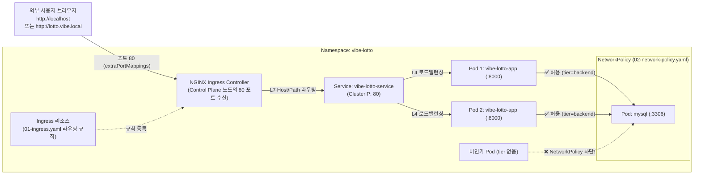

# Module 4: 클러스터 네트워킹 심화 (CoreDNS, Ingress, NetworkPolicy)

> **학습 목표**: Kubernetes 네트워크의 4대 축인 **Service(`ClusterIP` / `NodePort`), 내부 DNS(`CoreDNS`), L7 라우팅(`Ingress`), 그리고 파드 방화벽(`NetworkPolicy`)**의 동작 원리를 완벽히 이해하고, **`kubectl port-forward` 없이도 브라우저에서 `http://localhost`로 바로 접속되는 환경**을 구축합니다.

---

## 1. 개념과 원리 (Why & How)

### 1.1 왜 `Service` 앞에 `Ingress`를 또 두는가? (L4 vs L7)
지금까지 우리는 웹 앱에 접속하기 위해 터미널에 `kubectl port-forward svc/vibe-lotto-service 8080:80`을 켜두어야 했습니다. 실무에서는 수십 개의 마이크로서비스가 떠 있는데, 이를 외부 사용자에게 어떻게 노출할까요?



1. **`Service (NodePort / LoadBalancer)`의 한계**: L4(TCP/IP) 계층에서만 동작하므로 도메인 주소(`lotto.vibe.local` vs `admin.vibe.local`)나 URL 경로(`/api` vs `/`)를 구분하지 못합니다. 또한 서비스마다 클라우드 로드밸런서(AWS ALB/NLB)를 1개씩 만들면 비용이 수십 배로 늘어납니다.
2. **`Ingress` + `Ingress Controller`의 해결책**:
   - 클러스터 입구에 단 하나의 **Ingress Controller(예: NGINX)**를 띄워 80/443 포트를 열게 합니다.
   - 개발자는 YAML로 **`Ingress` 리소스(라우팅 표지판)**만 작성하면, NGINX Ingress Controller가 이를 읽어들여 도메인과 URL 경로에 따라 알맞은 내부 `Service`로 트래픽을 토스해 줍니다!

---

### 1.2 클러스터 내부 DNS (`CoreDNS`)의 정규 도메인(FQDN) 규칙 (CKA 100% 출제!)
왜 백엔드 파드에서 `DB_HOST: "mysql-service"`라고만 적어도 MySQL에 연결되었을까요?
클러스터 내부의 **CoreDNS** 서버가 모든 `Service`에 대해 아래 규칙으로 도메인 레코드를 자동 등록하기 때문입니다:

$$\text{<Service 이름>}.\text{<Namespace 이름>}.\text{svc.cluster.local}$$

- **같은 네임스페이스(`vibe-lotto`) 안에서 부를 때**: 그냥 **`mysql-service`** 로 생략 가능!
- **다른 네임스페이스(예: `default`)에서 `vibe-lotto`의 DB를 부를 때**: 반드시 **`mysql-service.vibe-lotto`** 또는 전체 주소인 **`mysql-service.vibe-lotto.svc.cluster.local`** 로 불러야 합니다!

---

## 2. 단계별 실습 가이드 (Step-by-Step Hands-On)

### Step 1: Kind 클러스터에 NGINX Ingress Controller 설치하기
Kubernetes에 `Ingress` YAML만 넣는다고 아무 일도 일어나지 않습니다. 반드시 그 규칙을 실제로 수행할 **Ingress Controller**가 클러스터에 설치되어 있어야 합니다! (CKA 시험 설명서에도 명시된 핵심 개념입니다.)

우리가 Module 1에서 `kind-config.yaml`을 만들 때 미리 `extraPortMappings`(80, 443 포트 연결)와 `ingress-ready=true` 라벨을 세팅해 두었기 때문에, 아래 공식 명령어 한 줄이면 즉시 설치됩니다!

```bash
# 1. Kind 전용 공식 NGINX Ingress Controller 설치
kubectl apply -f https://raw.githubusercontent.com/kubernetes/ingress-nginx/main/deploy/static/provider/kind/deploy.yaml

# 2. [멀티 노드 Kind 필수!] 컨트롤러 파드가 80/443 포트 매핑이 걸려 있는
#    Control Plane 노드('ingress-ready=true')에 스케줄링되도록 nodeSelector 패치!
kubectl patch deployment ingress-nginx-controller -n ingress-nginx \
  --type='json' \
  -p='[{"op": "add", "path": "/spec/template/spec/nodeSelector/ingress-ready", "value": "true"}]'

# 3. ingress-nginx 네임스페이스에 컨트롤러 파드가 Running(1/1)이 될 때까지 대기 (약 30~60초 소요)
kubectl wait --namespace ingress-nginx \
  --for=condition=ready pod \
  --selector=app.kubernetes.io/component=controller \
  --timeout=120s
```

### Step 2: `Ingress` 리소스 배포 및 포트포워딩 없이 접속하기!
컨트롤러가 준비되었다면, 이제 우리의 라우팅 규칙인 [`01-ingress.yaml`](./01-ingress.yaml)을 배포합니다.

```bash
# 1. 기존에 켜두었던 kubectl port-forward (8080:80)가 있다면 종료(Ctrl+C)해도 됩니다!
# 2. Ingress 리소스 생성
kubectl apply -f k8s/04-networking/01-ingress.yaml

# 3. 생성된 Ingress 확인 (CLASS가 nginx, HOSTS가 *, lotto.vibe.local 인지 확인)
kubectl get ingress -n vibe-lotto
```

#### 🎉 검증 1: 이제 `port-forward` 없이 바로 접속해 보세요!
1. Mac 웹 브라우저 주소창에 그냥 **`http://localhost`** 를 입력해 보세요!
   👉 포트 번호(`:8080`)도 필요 없고, 터미널에 `port-forward`를 켜둘 필요도 없이 **Vibe Lotto 6/45** 화면이 바로 뜹니다!
2. 터미널에서 가상 도메인(`lotto.vibe.local`) 라우팅 규칙도 동작하는지 `curl`의 `Host` 헤더로 테스트해 보세요:
   ```bash
   curl -I -H "Host: lotto.vibe.local" http://localhost/api/v1/system/info
   ```
   > `HTTP/1.1 200 OK`와 함께 `x-pod-hostname: vibe-lotto-app-...` 헤더가 찍히면 L7 도메인 라우팅 성공입니다!

---

### Step 3: CoreDNS 도메인 질의(`nslookup`) 직접 눈으로 확인하기 (CKA 단골 문제!)
CKA 시험에서 **"일회성 `busybox` 파드를 띄워서 특정 Service의 DNS 레코드를 `nslookup`으로 조회하라"**는 문제가 자주 출제됩니다.

```bash
# 일회성(--rm) busybox 파드를 띄워 mysql-service의 전체 DNS 이름(FQDN)과 IP를 조회하고 즉시 삭제합니다.
kubectl run dns-test --image=busybox:1.36 --rm -it --restart=Never -n vibe-lotto -- \
  nslookup mysql-service.vibe-lotto.svc.cluster.local
```
> 출력 결과에 `Name: mysql-service.vibe-lotto.svc.cluster.local`과 `Address: 10.96.x.x` (ClusterIP)가 나오면 정상입니다!

---

### Step 4: `NetworkPolicy` 방화벽 구조 및 CKA 핵심 문법 마스터하기
[`k8s/04-networking/02-network-policy.yaml`](./02-network-policy.yaml) 파일을 열어 주석을 꼭 읽어보세요!

```bash
# 1. MySQL 보호용 NetworkPolicy 배포
kubectl apply -f k8s/04-networking/02-network-policy.yaml

# 2. 생성된 NetworkPolicy 상세 규칙(PodSelector, Allowing ingress traffic) 확인
kubectl describe networkpolicy -n vibe-lotto mysql-access-policy
```

> **💡 CNI와 NetworkPolicy에 대한 실무/CKA 중요 상식**:
> - `Kind`의 기본 네트워크 플러그인(`kindnet`)은 가벼운 대신 `NetworkPolicy` 차단 기능을 강제하지 않고, **Calico**나 **Cilium** CNI가 설치된 클러스터(CKA 시험장의 기본 환경!)에서 실제 패킷 차단이 수행됩니다.
> - CKA 시험에서는 패킷 차단 여부보다 **`kubectl describe networkpolicy`를 보고 `podSelector`와 `ingress.from`의 AND / OR 조건을 정확히 작성했는가**를 채점합니다!

#### 🔥 CKA 시험 필수 암기: `from:` 아래의 대시(`-`) 하나 차이가 당락을 가릅니다!

```yaml
# [케이스 A: AND 조건] - 대시(-)가 맨 앞에 딱 1개만 있을 때
# 의미: 'default' 네임스페이스 안에 있으면서 동시에 'tier=backend' 라벨을 가진 파드만 허용!
ingress:
  - from:
      - namespaceSelector:
          matchLabels:
            kubernetes.io/metadata.name: default
        podSelector:
          matchLabels:
            tier: backend

# [케이스 B: OR 조건] - 대시(-)가 각각 2개 있을 때 (실수하기 가장 쉬움!)
# 의미: 'default' 네임스페이스의 모든 파드 허용 OR 현재 네임스페이스의 'tier=backend' 파드 모두 허용!
ingress:
  - from:
      - namespaceSelector:
          matchLabels:
            kubernetes.io/metadata.name: default
      - podSelector:
          matchLabels:
            tier: backend
```
이 차이를 확인하는 가장 좋은 방법은 `kubectl apply` 후 반드시 **`kubectl describe networkpolicy <이름>`**을 쳐서 영어 설명이 `and`로 묶여서 나오는지, 두 줄(`From:`이 두 번)로 나뉘어 나오는지 눈으로 확인하는 것입니다!

