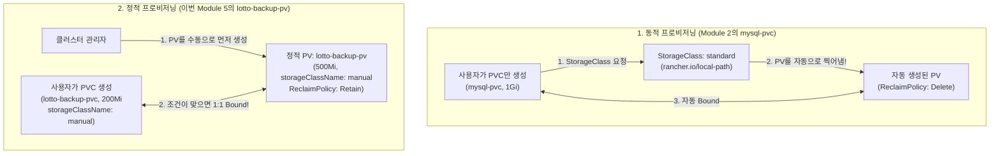

# Module 5: 영구 스토리지 마스터 (Static PV/PVC, StorageClass, Volume Types)

> **학습 목표**: CKA 시험의 **10% 비중**을 차지하는 스토리지 영역(`PersistentVolume`, `PersistentVolumeClaim`, `StorageClass`, `ReclaimPolicy`, `emptyDir`, `ConfigMap` 볼륨 마운트)의 동작 원리를 완벽히 체득하고, **앞선 Module 0 ~ 4의 설정(`nodeAffinity`, `NetworkPolicy`)과 100% 호환되는 MySQL 영구 백업 아키텍처**를 구축합니다.

---

## 1. 개념과 원리 (Why & How)

### 1.1 동적 프로비저닝(Dynamic) vs 정적 프로비저닝(Static) 비교
우리는 이미 두 가지 방식을 모두 다루게 됩니다:



### 1.2 PV와 PVC의 4단계 생명주기 (Lifecycle - CKA 단골!)
1. **`Available` (사용 가능)**: 관리자가 `PersistentVolume(PV)`을 막 생성하여 아직 어떤 `PVC`와도 연결되지 않은 자유 상태입니다.
2. **`Bound` (연결됨)**: 조건(`storageClassName`, `accessModes`, `storage` 용량)이 맞는 `PVC`를 만나 1:1로 짝이 맺어진 상태입니다.
3. **`Released` (해제됨 - 중요!)**: `ReclaimPolicy: Retain`인 PV에서 사용자가 **`PVC`를 삭제(`kubectl delete pvc`)했을 때**의 상태입니다.
   - **CKA 주의점**: `Released` 상태인 PV는 안에 이전 사용자의 데이터가 남아 있으므로, 새로운 PVC를 다시 만든다고 해서 **자동으로 다시 `Bound`되지 않습니다!** (다시 쓰려면 PV의 `spec.claimRef` 필드를 지워야 `Available`로 돌아옵니다.)
4. **`Failed` (실패)**: 자동 회수에 실패한 상태입니다.

---

## 2. 앞선 Module 0 ~ 4와의 호환성 체크리스트 (Zero-Error Design)

이번 Module 5 매니페스트를 작성할 때 이전 모듈들과 충돌이 나지 않도록 아래 3가지를 정밀하게 맞췄습니다:

1. **Module 4 `NetworkPolicy` (`mysql-access-policy`) 통과 보장**:
   - `mysql-backup-job`이 `mysql-service:3306`에 접속해 `mysqldump`를 떠야 하므로, 파드 템플릿에 `tier: backend` 라벨을 부여하여 방화벽 타임아웃(`ERROR 2003`)이 절대 발생하지 않도록 구성했습니다.
2. **Module 0 & Module 3 멀티 노드 `hostPath` 일치 (`nodeAffinity`)**:
   - 멀티 노드 클러스터(`worker`, `worker2`)에서 `hostPath` 볼륨을 쓸 때, 백업 Job은 `worker2` 노드에 파일을 저장했는데 검증 파드(`backup-inspector`)가 `worker` 노드에 뜨면 파일이 안 보이는 현상이 발생합니다.
   - 이를 방지하기 위해 두 파드 모두 `nodeAffinity` (`tier: backend` -> `vibe-cluster-worker2` 노드)와 `tolerations`를 동일하게 설정했습니다.

---

## 3. 단계별 실습 가이드 (Step-by-Step Hands-On)

### Step 1: 현재 클러스터의 동적 `StorageClass`와 `mysql-pvc` 상태 확인
먼저 Module 2에서 만들었던 `mysql-pvc`가 어떻게 동적으로 PV를 만들어 쓰고 있는지 확인해 봅시다.

```bash
kubectl get sc,pv,pvc -n vibe-lotto
```
- `storageclass/standard (default)`가 자동으로 `pvc-b20f...`라는 이름의 PV(1Gi, `ReclaimPolicy: Delete`)를 만들어 `mysql-pvc`에 붙여준 것을 볼 수 있습니다!

### Step 2: 정적 PV/PVC 생성 및 MySQL 당첨 데이터 `.sql` 백업 Job 실행
이제 [`k8s/05-storage/01-static-pv-and-backup.yaml`](./01-static-pv-and-backup.yaml)을 적용하여:
1. 500Mi짜리 정적 PV (`lotto-backup-pv`, `ReclaimPolicy: Retain`) 생성
2. 200Mi를 요청하는 PVC (`lotto-backup-pvc`) 생성 및 `Bound`
3. `mysql-backup-job`이 실행되어 MySQL의 5등 이상 당첨 기록을 `/backup/winning_records_backup.sql`로 영구 저장!

```bash
# 1. 정적 PV, PVC 및 MySQL 백업 Job 배포
kubectl apply -f k8s/05-storage/01-static-pv-and-backup.yaml

# 2. lotto-backup-pv와 lotto-backup-pvc가 즉시 'Bound' 되었는지 확인!
#    (PV 용량은 500Mi이므로 PVC도 500Mi로 바인딩되며, RECLAIM POLICY가 'Retain'인 것을 확인하세요)
kubectl get pv,pvc -n vibe-lotto

# 3. 백업 Job이 Completed(0/1) 되었는지 확인 후 백업 결과 로그 출력!
kubectl wait --for=condition=complete job/mysql-backup-job -n vibe-lotto --timeout=30s
kubectl logs -n vibe-lotto job/mysql-backup-job
```

### Step 3: 멀티 컨테이너 검증 파드로 `PVC` + `ConfigMap 볼륨` + `emptyDir` 동시 확인!
백업 Job 파드는 이미 종료(`Completed`)되었습니다. 과연 완전히 다른 새로운 파드(`backup-inspector`)에서 같은 PVC를 마운트했을 때 백업 파일이 그대로 들어 있을까요?

[`k8s/05-storage/02-storage-inspector-pod.yaml`](./02-storage-inspector-pod.yaml)을 배포해 확인합니다.

```bash
# 1. 2개의 컨테이너(verifier + sidecar-reader)를 가진 검증 파드 배포
kubectl apply -f k8s/05-storage/02-storage-inspector-pod.yaml

# 2. 파드가 Running(2/2)이 될 때까지 대기
kubectl wait --for=condition=ready pod/backup-inspector -n vibe-lotto --timeout=30s

# 3. 첫 번째 컨테이너(verifier)가 PVC와 ConfigMap 볼륨에서 읽은 로그 확인
kubectl logs -n vibe-lotto pod/backup-inspector -c verifier

# 4. 두 번째 사이드카 컨테이너(sidecar-reader)가 emptyDir 공유 볼륨에서 읽은 로그 확인
kubectl logs -n vibe-lotto pod/backup-inspector -c sidecar-reader

# 5. 실제로 백업된 SQL 덤프 파일(.sql)의 INSERT 구문 내용 직접 눈으로 확인하기!
kubectl exec -n vibe-lotto pod/backup-inspector -c verifier -- \
  grep "INSERT INTO" /mnt/backup-archive/winning_records_backup.sql
```
> 5번 명령어를 쳤을 때 우리가 당첨시켰던 로또 번호들의 `INSERT INTO lotto_winning_records VALUES ...` SQL 문이 그대로 출력되면 정적 PV/PVC 백업 아키텍처가 100% 성공한 것입니다!

---

### Step 4: (보너스) 워커 노드(`vibe-cluster-worker2`)의 실제 디스크(`hostPath`) 직접 열어보기
우리의 `lotto-backup-pv`는 `vibe-cluster-worker2` 노드의 `/tmp/vibe-lotto-backups` 디렉토리에 연결되어 있습니다. 진짜로 노드 안에 파일이 생겼는지 `docker exec`로 확인해 보세요!

```bash
docker exec -it vibe-cluster-worker2 ls -lh /tmp/vibe-lotto-backups
```
> `last_backup_info.txt`와 `winning_records_backup.sql`이 워커 노드 디스크에 안전하게 저장되어 있어, 파드를 지우든 PVC를 지우든(`Retain` 정책) 절대 날아가지 않습니다!
