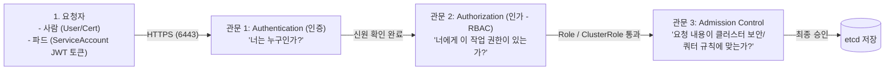
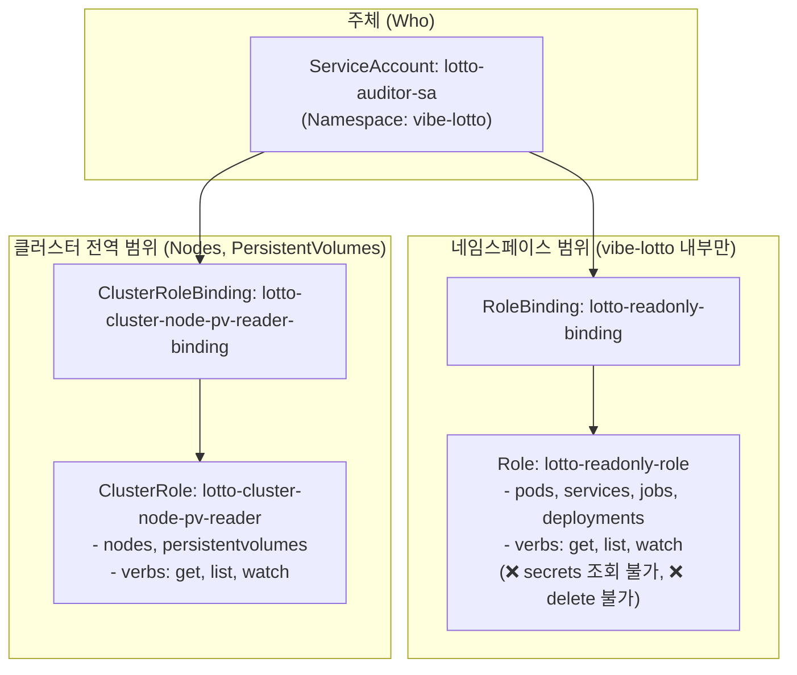

# Module 6: 클러스터 보안 및 접근 제어 (RBAC, ServiceAccount, SecurityContext)

> **학습 목표**: Kubernetes API 서버의 보안 3단계 관문(**인증 → 인가(RBAC) → Admission Control**)과 **`ServiceAccount` + `Role`/`ClusterRole` + `RoleBinding`/`ClusterRoleBinding`**의 연결 구조를 완벽히 이해하고, 컨테이너 권한 탈취를 방어하는 **`SecurityContext`**와 CKA 시험 100% 출제 명령어인 **`kubectl auth can-i`**를 실습합니다.

---

## 1. 개념과 원리 (Why & How)

### 1.1 Kubernetes API 요청의 3단계 보안 관문
사용자(`kubectl`)나 클러스터 내부의 파드(`ServiceAccount`)가 `kube-apiserver`에 요청을 보낼 때 항상 아래 3단계를 통과해야 합니다:



### 1.2 RBAC 4총사 관계도 (`Role` vs `ClusterRole`)
CKA 시험에서 가장 많이 출제되는 RBAC 구조입니다:



- **언제 `Role`을 쓰고 언제 `ClusterRole`을 쓰나요?**
  - `pods`, `services`, `deployments`, `secrets`, `pvc`처럼 **특정 네임스페이스 안에 속하는 리소스**만 허용할 때는 **`Role` + `RoleBinding`**을 씁니다.
  - `nodes`(워커 노드), `persistentvolumes`(Module 5의 `lotto-backup-pv`), `namespaces`처럼 **네임스페이스가 없는 클러스터 전역 리소스**를 조회하거나, **모든 네임스페이스의 파드를 한꺼번에 조회**해야 할 때는 반드시 **`ClusterRole` + `ClusterRoleBinding`**을 써야 합니다!
  - *(참고: 어떤 리소스가 네임스페이스 소속인지 전역인지 헷갈릴 때는 `kubectl api-resources --namespaced=false`를 치면 전역 리소스 목록이 쫙 나옵니다!)*

---

## 2. 앞선 Module 0 ~ 5와의 호환성 체크리스트 (Zero-Conflict Design)

이번 Module 6 매니페스트([`02-security-context-and-auditor.yaml`](./02-security-context-and-auditor.yaml))에서 기존 `vibe-lotto-app` Deployment를 업데이트할 때 이전 모듈의 기능이 절대 깨지지 않도록 아래 항목을 100% 보존했습니다:
1. **Module 2 호환**: `initContainers (wait-for-mysql)`, `ConfigMap`/`Secret` 환경변수, `readinessProbe`/`livenessProbe`,そして `Dockerfile`의 유저 UID(`10001`)와 `securityContext.runAsUser: 10001`을 정확히 일치시켰습니다.
2. **Module 3 호환**: `podAntiAffinity`를 그대로 유지하여 롤링 업데이트 후에도 `worker`와 `worker2` 노드에 1개씩 분산 배치됩니다.
3. **Module 4 호환**: 파드 라벨 `tier: backend`를 그대로 유지하여 `vibe-lotto-service`(Ingress 연결)와 `mysql-access-policy`(`NetworkPolicy` 방화벽)를 모두 통과합니다.

---

## 3. 단계별 실습 가이드 (Step-by-Step Hands-On)

### Step 1: RBAC 리소스(`ServiceAccount`, `Role`, `ClusterRole`, `Binding`) 배포
```bash
# 1. RBAC 5종 리소스 배포
kubectl apply -f k8s/06-security/01-rbac.yaml

# 2. 생성된 ServiceAccount, Role, RoleBinding 확인
kubectl get sa,role,rolebinding -n vibe-lotto
```

### Step 2: 🔥 CKA 시험 필수 명령어 — `kubectl auth can-i`로 권한 검증하기!
파드를 띄우지 않고도 내가 만든 `ServiceAccount`에게 권한이 제대로 들어갔는지 1초 만에 테스트하는 CKA 시험 단골 명령어입니다. 터미널에서 아래 4줄을 차례대로 쳐보세요!

```bash
# 1. lotto-auditor-sa가 vibe-lotto 네임스페이스의 pods를 조회(list)할 수 있는가? -> 결과: yes
kubectl auth can-i list pods -n vibe-lotto --as=system:serviceaccount:vibe-lotto:lotto-auditor-sa

# 2. 클러스터 전역 리소스인 persistentvolumes(PV)를 조회할 수 있는가? (ClusterRole 덕분) -> 결과: yes
#    (참고: PV는 네임스페이스에 속하지 않는 전역 리소스이므로 '-n vibe-lotto' 없이 실행합니다!)
kubectl auth can-i list pv --as=system:serviceaccount:vibe-lotto:lotto-auditor-sa

# 3. 보안을 위해 제외한 secrets(DB 비밀번호)를 조회(get)할 수 있는가? -> 결과: no (정상 차단!)
kubectl auth can-i get secrets -n vibe-lotto --as=system:serviceaccount:vibe-lotto:lotto-auditor-sa

# 4. 파드를 마음대로 삭제(delete)할 수 있는가? -> 결과: no (읽기 전용이므로 정상 차단!)
kubectl auth can-i delete pods -n vibe-lotto --as=system:serviceaccount:vibe-lotto:lotto-auditor-sa
```
> **암기 포인트**: `--as=system:serviceaccount:<네임스페이스명>:<서비스어카운트명>` 형식은 CKA 시험에서 내가 푼 RBAC 문제가 맞았는지 검산할 때 100% 사용하는 필수 치트키입니다!

---

### Step 3: `vibe-lotto-app`에 강화된 `SecurityContext` + `ServiceAccount` 적용 및 보안 감사 파드 실행
이제 [`02-security-context-and-auditor.yaml`](./02-security-context-and-auditor.yaml)을 배포하여:
- `vibe-lotto-app`에 `serviceAccountName: lotto-auditor-sa`와 커널 권한 상승 차단(`allowPrivilegeEscalation: false`, `capabilities.drop: ["ALL"]`, `seccompProfile: RuntimeDefault`)을 적용하고,
- 실제로 파드 내부에서 K8s API를 호출해 보는 `rbac-security-auditor` 파드를 띄웁니다.

```bash
# 1. 강화된 SecurityContext 및 감사 파드 배포
kubectl apply -f k8s/06-security/02-security-context-and-auditor.yaml

# 2. vibe-lotto-app 롤링 업데이트 완료 대기 및 감사 파드 Ready 대기
kubectl rollout status -n vibe-lotto deploy/vibe-lotto-app
kubectl wait --for=condition=ready pod/rbac-security-auditor -n vibe-lotto --timeout=60s

# 3. 감사 파드(rbac-security-auditor)가 파드 내부에서 수행한 4단계 보안 검증 리포트 로그 확인!
kubectl logs -n vibe-lotto pod/rbac-security-auditor
```
> 로그를 확인해 보시면:
> - `[1]` 프로세스가 `uid=10001 gid=10001` (Non-root)로 실행 중이고,
> - `[2]` 파드 내부에서 `kubectl get pods -n vibe-lotto`와 `[3]` `kubectl get pv`는 성공하며,
> - `[4]` `kubectl get secrets -n vibe-lotto`를 시도했을 때 **`Error from server (Forbidden): secrets is forbidden: User "system:serviceaccount:vibe-lotto:lotto-auditor-sa" cannot list resource "secrets"`** 에러가 뜨며 완벽하게 방어되는 것을 눈으로 확인하실 수 있습니다!

### Step 4: 기존 웹 서비스(`http://localhost`) 정상 동작 확인
강화된 보안 설정(`capabilities.drop: ["ALL"]`, `readOnly` 등)이 적용된 후에도 우리 로또 웹 서비스와 MySQL 연동이 아무 문제 없이 잘 돌아가는지 확인합니다:
```bash
curl -i -H "Host: lotto.vibe.local" http://localhost/api/v1/system/info
```
> `200 OK`가 떨어지면 보안 강화(Hardening)와 무중단 배포까지 완벽하게 성공한 것입니다!
